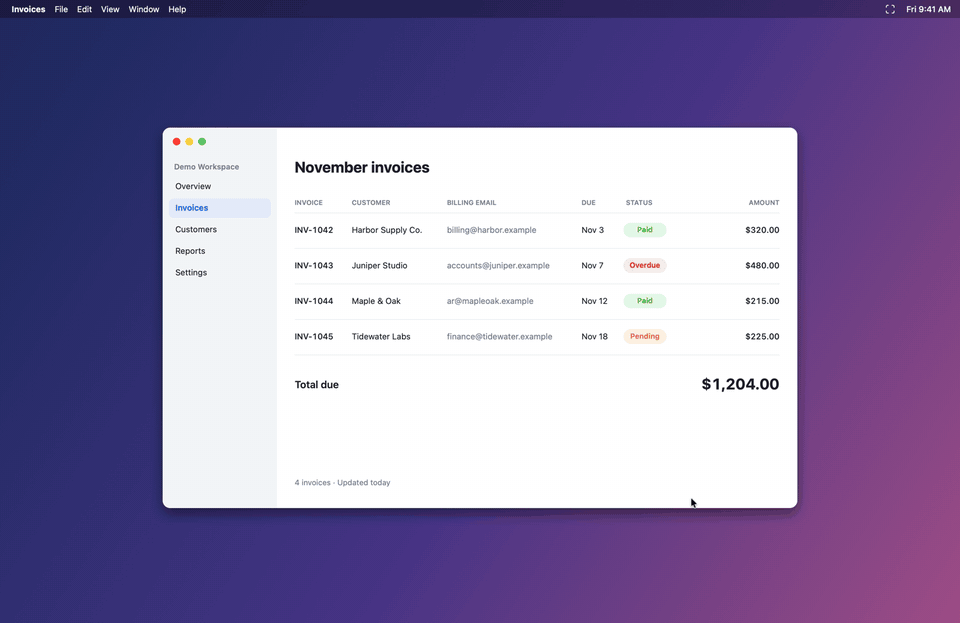
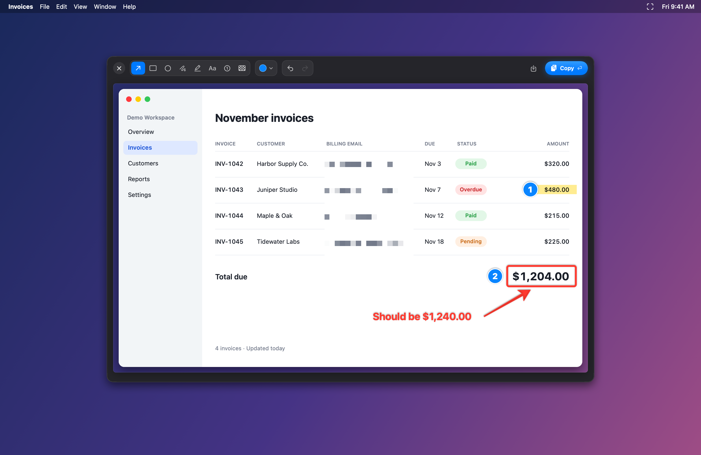
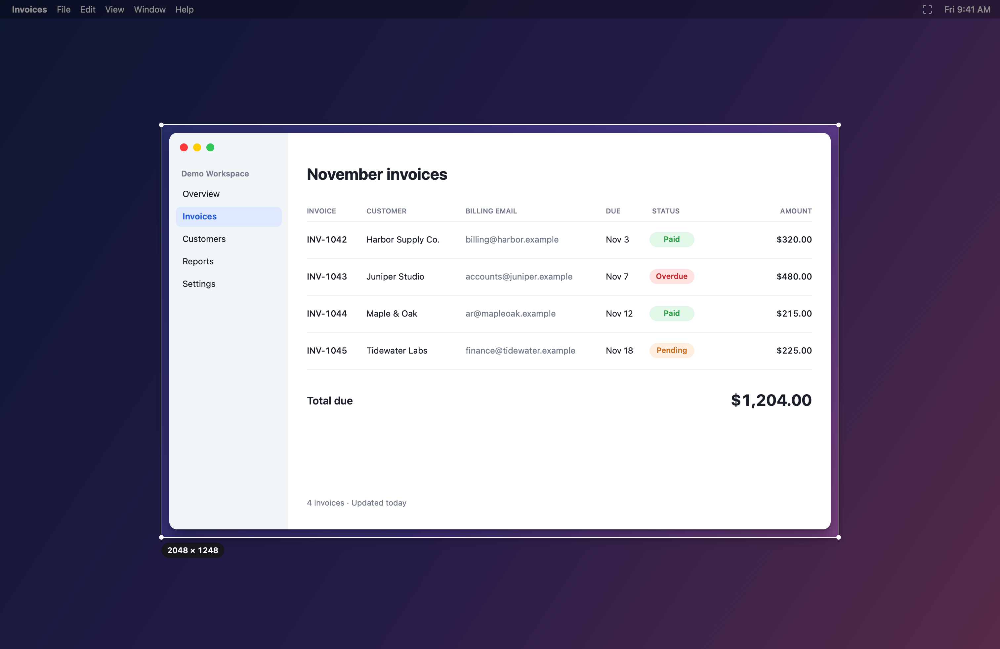
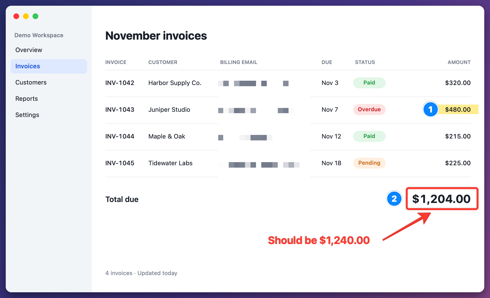

# ShotX

A tiny native Mac app that takes you from screenshot to annotated image in seconds, all from your keyboard (about 2 MB, native Swift).

**⌘⇧A** → drag to select an area → annotate → **⏎** copies to the clipboard.



[Watch the demo as an MP4](docs/demo.mp4)

## Screenshots



| Select an area | Exported result |
| --- | --- |
|  |  |

The demo and screenshots show the real ShotX interface on a fictional sample app.

## Features

- **Eight annotation tools:** arrow, rectangle, ellipse, pen, highlighter, text, numbered steps, and pixelate for hiding sensitive details
- **Keyboard-first:** every tool has a single-key shortcut, with eight colors on keys 1–8
- **Clean lines:** hold Shift to snap arrows to 45°, draw perfect squares and circles, or keep highlights straight
- **Sharp by default:** captures stay at your display's native resolution from start to finish
- **Stays out of your way:** lives in the menu bar, with an optional Launch at Login setting

Requires macOS 14 or later.

## Build & install

```sh
./build.sh            # builds build/ShotX.app
./build.sh --install  # copies to /Applications and launches
```

On first capture, grant **Screen & System Audio Recording** to ShotX in System Settings, then relaunch.
Tip: with an Apple Development certificate in your keychain the build is signed with it, so the
permission survives rebuilds (ad-hoc builds need it re-granted after each rebuild).

## Shortcuts

| Key | Action |
| --- | --- |
| ⌘⇧A | Capture area (Shift while dragging = square, Esc / right-click = cancel) |
| A R O P H T N B | Arrow, Rectangle, Ellipse, Pen, Highlighter, Text, Step number, Pixelate |
| 1–8 | Pick color |
| Shift (drawing) | Snap arrow to 45°, square/circle shapes, straight highlighter |
| ⌘Z / ⇧⌘Z | Undo / Redo |
| ⏎ or ⌘C | Copy to clipboard & close |
| ⌘S | Save PNG |
| Esc | Discard |

Screenshots stay at the display's native resolution (e.g. 2× on Retina) end to end; the
editor only scales the preview to fit on screen.

## Icon

`Icon/make_icon.swift` draws the icon in code; `Resources/AppIcon.icns` is generated from it with `iconutil`.
